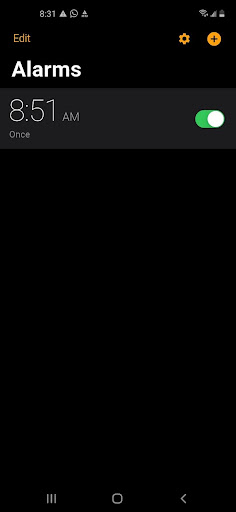
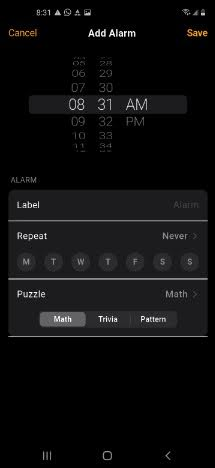
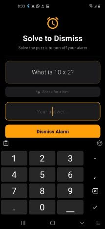

# NoSnooze

**A puzzle-based alarm app for Android that makes you wake your brain up before you can silence your phone.**

Instead of tapping snooze, you have to solve a short puzzle (math, pattern, or trivia) to dismiss the alarm. The goal is to break the habit of passive morning scrolling, cut down on sleep inertia, and help you start the day mentally engaged.

Built with Flutter and Dart.

<p align="center">
  
  
  
</p>

## Features

- **Puzzle-to-dismiss alarms:** an alarm only stops when you answer its puzzle correctly
- **Three puzzle types:** math, pattern, and trivia
  - Math and pattern puzzles are generated locally
  - Trivia questions come from the [Open Trivia DB](https://opentdb.com/) API, with a local fallback if you're offline
- **Hints:** shake your phone (or swipe down) to reveal a hint
- **Flexible scheduling:** pick a time with a native-style picker and choose which days an alarm repeats
- **Edit mode with undo/redo:** delete or change alarms and step backward or forward through your edits
- **Lock-screen alarms:** the alarm screen appears over the lock screen, including when the app was closed
- **Survives reboots:** alarms are rescheduled automatically after the phone restarts
- **Localization:** English and Spanish
- **Settings screen** with a language selector and a live analog clock built with a custom painter

## Tech Stack

| Area | Tools |
| --- | --- |
| Framework | Flutter, Dart |
| State management | Provider (`ChangeNotifier`) |
| Persistence | SharedPreferences |
| Alarms & notifications | `alarm` package, timezone data |
| Trivia data | Open Trivia DB API |
| Localization | `flutter gen-l10n` with ARB files |

## Getting Started

### Requirements

- Flutter SDK >= 3.38.4
- Dart SDK >= 3.11.0 and < 4.0.0
- Android device or emulator (minSdk is set by the Flutter Gradle plugin)
- Internet access is needed only for trivia puzzles. If it's unavailable, the app falls back to math puzzles.

> iOS has not been tested.

### Run the app

```bash
cd code/nosnooze
flutter pub get
flutter run
```

All dependencies are listed in `pubspec.yaml`. No API keys are needed.

### Android permissions

The required permissions are already declared in `AndroidManifest.xml`, so no extra setup is needed.

| Permission | Why it's needed |
| --- | --- |
| `POST_NOTIFICATIONS` | Delivering notifications on Android 13+ |
| `SCHEDULE_EXACT_ALARM` / `USE_EXACT_ALARM` | Firing alarms at the exact time |
| `USE_FULL_SCREEN_INTENT` | Showing the alarm over the lock screen |
| `FOREGROUND_SERVICE` | Keeping the alarm alive in the background |
| `RECEIVE_BOOT_COMPLETED` | Rescheduling alarms after a reboot |
| `VIBRATE` / `WAKE_LOCK` | Vibration and waking the device |

## Project Structure

All application source lives under `lib/`.

```
lib/
├── main.dart              # App entry point and startup
├── models/                # Data models
├── providers/             # State management
├── screens/               # UI screens
├── utils/                 # Alarm scheduling and puzzle generation
├── widgets/               # Reusable widgets
├── l10n/                  # English and Spanish translation files (.arb)
└── generated/             # Auto-generated localization code (do not edit)
```

### Details

**`main.dart`** initializes the alarm package, notification permissions, and timezone data. It listens to the `Alarm.ringing` stream and navigates to the dismiss screen when an alarm fires, including on a cold start.

**`models/`**
- `alarm.dart`: alarm data model, the `PuzzleType` and `Weekday` enums, JSON serialization, and display-label helpers
- `puzzle.dart`: puzzle model (question, answer, optional hint, category) with a `check()` method for validating answers
- `weekday.dart`: re-exports `Weekday` from `alarm.dart`

**`providers/`**
- `alarm_provider.dart`: a `ChangeNotifier` that owns the alarm list, loads and saves it with SharedPreferences, schedules alarms through `NotificationHelper`, and provides full undo/redo using snapshot stacks
- `locale_provider.dart`: persists and restores the user's chosen language

**`screens/`**
- `home_screen.dart`: the alarm list, showing each alarm's time (AM/PM) and repeat days, with an edit mode (slide-in delete buttons) and undo/redo controls
- `add_edit_alarm_screen.dart`: create or edit an alarm using a `CupertinoDatePicker`, an expanding repeat-day selector, and a puzzle-type segmented control
- `alarm_dismiss_screen.dart`: shown when an alarm fires. It loads the matching alarm, generates a puzzle, supports shake or swipe-down for hints, and only dismisses on a correct answer
- `settings_screen.dart`: language selector and an analog clock demo

**`utils/`**
- `notification_helper.dart`: wraps the alarm package and handles timezone setup, permission requests, scheduling the next trigger, and cancellation
- `puzzle_service.dart`: generates puzzles. Math and pattern puzzles are created locally, and trivia is fetched from the Open Trivia DB API with a local fallback

**`widgets/`**
- `analog_clock.dart`: a live analog clock drawn with `CustomPainter` (tick marks, hour, minute, and second hands)

**`generated/`** and **`l10n/`**: localization files are generated by `flutter gen-l10n`. Don't edit `generated/` directly. Edit `l10n/app_en.arb` and `l10n/app_es.arb`, then re-run `flutter gen-l10n`.

## Engineering Notes

Getting alarms to fire reliably on Android took more work than expected. A few of the problems solved along the way:

- **Silent alarm failures:** scheduled alarms were silently dropped because the required broadcast receivers weren't declared in the Android manifest, which produces no runtime error
- **Silent mode and Do Not Disturb:** alarm audio is routed through Android's alarm stream so it still plays when the phone is silenced
- **Cold-start crashes:** app state is pre-loaded before `runApp`, so alarms that launch the app through a full-screen intent open correctly

## Status

Actively developed. Android is the supported platform.
